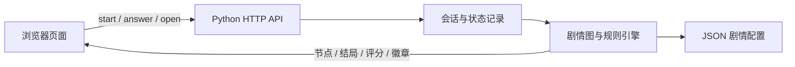

# 反诈陪练｜终场前的一张票

一款由剧情选择驱动的反诈互动演练。玩家经历票务冒充、熟人账号仿冒和投资诱导等场景，在每个关键节点选择如何核实、止付、留证和求助；后端按实际选择推进剧情，并生成对应结局与复盘。

> 所有付款均为虚构模拟，不连接真实支付渠道。项目不使用生成式 AI 判断用户回答；自由回答按配置的关键词规则匹配。

## 反诈演练特色

- **核实信息来源**：从独立找到的官方渠道核验票务信息，不使用可疑消息提供的联系方式。
- **识别付款升级**：演练个人收款码、重复转账、退款承诺，以及从小额交易引向高额投资的过程。
- **区分熟悉感与身份**：头像、昵称、共同经历和真实发货都不能单独证明账号属于熟人。
- **练习及时处置**：通过停止联系、保存必要记录、联系银行或平台、举报和脱敏提醒等选择，观察路径变化。
- **按路径复盘**：15 个剧情节点、16 个结局；E15/E16 等结局取决于此前核实与付款记录。评分、徽章和复盘由服务端根据会话记录计算。

## 技术栈

| 部分 | 技术 | 用途 |
|---|---|---|
| 前端 | HTML、CSS、原生 JavaScript | 剧情界面、场景资源、选项与自由回答交互 |
| 后端 | Python 标准库 `http.server` | HTTP API、会话控制、输入校验与复盘响应 |
| 剧情与规则 | JSON 配置 | 节点、选项目标、条件分支、结局文案及评分/徽章规则 |
| 会话 | 进程内存储，2 小时空闲过期 | 服务端记录选择和模拟付款状态，不采信客户端提交的分数 |

项目没有第三方 Python 运行依赖，也没有前端构建步骤。当前会话保存在单进程内存中；服务重启后会话消失，不适用于需要持久化或多实例共享会话的部署。

## 架构



浏览器通过 `/api/story/start` 创建会话，通过 `/api/story/answer` 提交固定选项，通过 `/api/story/open` 提交自由回答。后端返回下一节点或结局复盘。`/api/story/state`、`/api/story/review` 和 `/api/story/stop` 提供状态、复盘和中止接口。

## 本地运行

在项目根目录打开两个 PowerShell 窗口。

窗口一：

```powershell
cd backend
python app.py
```

窗口二：

```powershell
cd frontend
python -m http.server 8080 --bind 127.0.0.1
```

浏览器打开 <http://localhost:8080>。前端默认请求 `http://localhost:5000`，可在加载 `frontend/src/game.js` 前设置 `window.ANTIFRAUD_API_BASE` 覆盖 API 地址。后端当前 CORS 只允许 loopback 开发来源；部署到其他域名时需按实际来源配置。

## 目录

```text
backend/   Python API、会话引擎、旧版配置与前端图配置
frontend/  页面、交互代码、剧情展示数据与美术资源
docs/      对接差距清单与后端改造建议
```

旧的 `frontend/examples/backend-adapter.example.js` 使用已废弃接口，已从 Git 跟踪列表排除；页面当前直接通过 `frontend/src/game.js` 请求会话 API。
